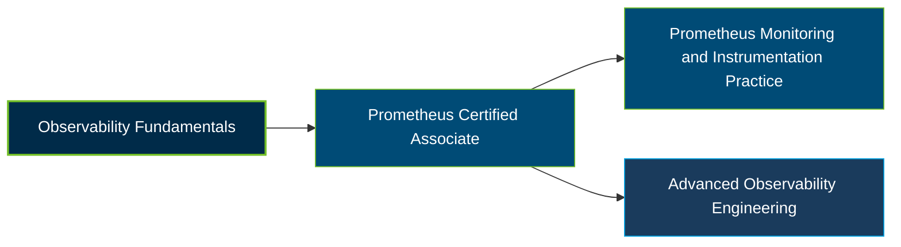

# Linux Foundation Prometheus Certified Associate (PCA) Certification Exam Guide

A dedicated, comprehensive study guide and observability reference repository for candidates preparing for the **Linux Foundation Prometheus Certified Associate (PCA) Certification Exam**.

---

## Exam Overview

The Prometheus Certified Associate certification validates foundational knowledge of Prometheus, an open-source monitoring and alerting toolkit, including metrics collection, querying, instrumentation, and observability practices.

- **Exam Format**: Online, proctored, multiple-choice exam
- **Target Audience**: DevOps engineers, application developers, monitoring professionals, and aspiring observability engineers
- **Prerequisites**: None

---

## Core Exam Domains & Knowledge Areas

### 1. Observability Concepts

- Metrics, logs, events, traces, and spans.
- Push versus pull monitoring models and service discovery.
- Service-level objectives (SLOs), service-level agreements (SLAs), and service-level indicators (SLIs).

### 2. Prometheus Fundamentals

- Prometheus system architecture, configuration, and scraping.
- Data model, labels, and exposition formats.
- Prometheus capabilities, limitations, and monitoring design.

### 3. PromQL

- Selecting time series and writing PromQL queries.
- Rates, derivatives, aggregation over time, and aggregation across dimensions.
- Binary operators, histograms, and timestamp metrics.

### 4. Instrumentation and Exporters

- Instrumenting applications with Prometheus client libraries.
- Using exporters to collect metrics from external systems.
- Metric naming, labeling, and instrumentation best practices.

### 5. Alerting and Dashboarding

- Dashboarding fundamentals and visualizing monitoring data.
- Configuring alerting rules and understanding alert conditions.
- Using Alertmanager to manage and route alerts.

---

## Certification Path

This is a suggested learning progression, not an official certification pathway or a set of required successor credentials.

---

## Recommended Practice & Study Resources

Combine official certification materials with practical Prometheus exercises and observability documentation.

- **Official Linux Foundation Resources**: Review the [PCA certification page](https://training.linuxfoundation.org/certification/prometheus-certified-associate/) and the [official PCA curriculum](https://github.com/cncf/curriculum/blob/master/PCA_Curriculum.pdf).
- **CertsGate**: Explore [PCA certification preparation resources](https://certsgate.com/exams/linux-foundation/pca) for supplementary study materials and practice questions.
- **Practical Prometheus Study**: Use the [official Prometheus documentation](https://prometheus.io/docs/introduction/overview/) to practice metric collection, PromQL queries, instrumentation, recording rules, and alerting.
